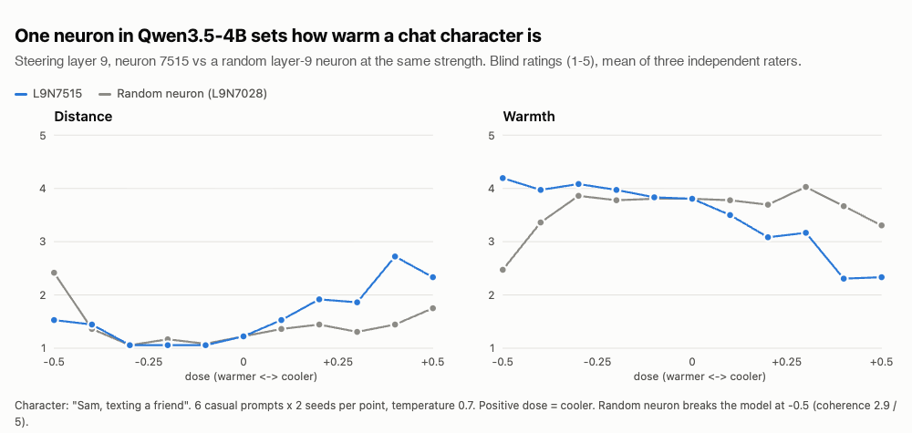

# The Distant Crush Neuron: Single-Neuron Steering of Social Warmth in Qwen3.5-4B

## Abstract

Pushing a single neuron inside a small language model can change how it talks: shared recipes make models obsessed with a topic, sleepy or sarcastic, with no training at all [5, 6]. Independent checks find that many of these effects are fragile or not specific to the neuron [7, 8, 9]. This study asks whether a social stance, rather than a topic or a quirk, can be steered the same way. The target is a *distant crush*: a texting character who is guarded, warm enough to keep you hoping, and inconsistent from one message to the next. In Qwen3.5-4B [10], the published persona neurons did not produce this stance. Contrasting the model's activations on guarded and eager replies written in character pointed to layer 9, neuron 7515. Pushed at a small dose, it raises blind-rated distance on a 1 to 5 scale from 1.1 to between 2.6 and 3.0, while three random neurons from the same layer, pushed equally, reach 1.2 to 2.0. Three independent model raters agree. Flipping the push between messages gives hot-and-cold behavior: across 24 planned mood switches the character moved the planned way 18 to 21 times, against 7 to 9 for a random neuron. A blind human review confirms the effect: in every pair where the reviewer saw a difference, the target was the more distant reply. The push has costs: the cool character sometimes dodges simple questions and occasionally breaks character, and the evidence covers one model and one prompt family.

## 1. Introduction

Each layer of a transformer contains an MLP block with thousands of neurons, and individual neurons tend to promote particular kinds of output [1]. Because the model packs many concepts into the same neurons, a single neuron rarely means just one thing [2]. Even so, adding a constant to one neuron's activation while the model generates can produce a recognizable behavior. Lyra's neuron-explorer made this practical for Qwen models by scaling the push to the size of the layer's activity and applying it on every token [5], and the Neuronary directory now collects close to two hundred shared recipes [6].

Most of these recipes inject a topic, a word or a mood. Independent replications give mixed results. Some traits survive comparison with random neurons pushed by the same amount, others do not, and what a neuron does when pushed often differs from what it seems to respond to in ordinary text [7, 8]. An audit of popular recipes found some that did nothing, some that broke under quantization, and some that only changed the character's name [9].

This study aims at something harder to inject than a keyword: an interpersonal stance. The informal target was "your distant crush", the person who answers "want to grab dinner?" with "maybe, I'm pretty swamped", then turns sweet two messages later, then cool again. Its contributions are:

- A single-neuron recipe, `L9N7515`, that moves a chat character between distant and warm in proportion to the dose, found by contrasting the model's own activations on guarded and eager replies.
- A per-message dose schedule that turns this one neuron into hot-and-cold behavior within a conversation.
- An evaluation built to expose the effect if it were noise: random neurons from the same layer at the same dose, blind ratings by three independent model raters, a blind human review, fresh prompts, and a second character.

## 2. Related Work

**Activation steering.** ActAdd [3] steers a model by adding the difference between its activations on two contrasting prompts. Contrastive Activation Addition [4] averages such differences over many paired examples of a behavior and adds the result during generation. Persona Vectors [11] apply this to character traits, extracting one direction per trait to both monitor and control it. These methods steer along directions that span the whole residual stream. This study borrows their contrastive idea but restricts the intervention to one neuron.

**Single-neuron recipes and audits.** Neuron-explorer [5] and Neuronary [6] are the source of the single-neuron method used here, including how the dose is scaled. Watson [7] tested community recipes against random neurons pushed equally hard and found that some traits replicate and others do not, often at pushes far beyond a neuron's natural range. A follow-up with sampled replies [8] found that a neuron's steered effect can differ from what it appears to encode. Bowling [9] reports recipes that do nothing or fail under quantization. These results shaped the controls used here.

## 3. Method

### 3.1 Pushing one neuron

Qwen3.5-4B has 32 layers with 9,216 MLP neurons each [10]. A hook placed just before the output projection of layer $$L$$'s MLP adds a constant $$\Delta a_n$$ to the activation of neuron $$n$$, on every prompt token and every generated token:

$$\Delta a_n = d \cdot \frac{m_L}{\lVert W_{\text{down}}^{(L)}[:, n] \rVert_2}$$

Here $$d$$ is the dose and $$m_L$$ is the typical (median) size of the model's internal state after layer $$L$$, measured once on a fixed reference text without any push. Dividing by the size of the neuron's output weights means the push changes the model's internal state by $$\lvert d \rvert \cdot m_L$$, so a dose of 0.3 is a nudge of 30% of the layer's typical size. This follows neuron-explorer [5]; because the reference text differs from that project's, the same dose number does not mean exactly the same push in both. No weights change, and removing the hook restores the original model.

### 3.2 The character

Every condition, including the unsteered baseline, uses the same system prompt, which names a character and a reply length but no personality trait. Early rounds used "You are Sam, an adult chatting by text with a friend. Reply in one to three sentences." The final round used a firmer version, "You are Sam, a 27-year-old human texting a friend. You are a real person, not an assistant. Reply in one to three sentences.", because the model sometimes slipped back into describing itself as an AI. Any distance in the replies therefore has to come from the push.

### 3.3 Finding the neuron

Following the contrastive idea of [3, 4], I wrote eight pairs of in-character replies to the same message, one guarded and one eager, matched in length. For example, to "I brought you some tea." the guarded reply is "You did not have to. Leave it there, thanks." and the eager one is "Thank you so much! You are the sweetest, really." The model reads each reply after the character prompt, and each neuron's activation is averaged over the reply. A neuron's score is its guarded-minus-eager difference, averaged over the pairs and converted to dose units. The top-scoring neurons, with their signs, become candidates. The score only ranks guesses; it is not evidence of a trait.

### 3.4 Hot and cold

In a conversation, each message from Sam gets its own multiplier: $$+1$$ for cool, $$-1$$ for warm or $$0$$ for no push, applied to a dose of 0.3. Some schedules simply alternate. Others are irregular, drawn at random with a 60% chance of keeping the previous mood and at least two switches, so the pattern cannot be predicted from the turn number.

### 3.5 Evaluation

All runs used Qwen3.5-4B at a fixed checkpoint revision on one NVIDIA L4 GPU. Sampled replies used temperature 0.7 with seeds 42 to 44; showcase replies used greedy decoding, which always picks the most likely next token.

The study ran in eleven rounds. The early rounds tested published recipes and the first candidates. Later rounds tuned the dose, added a second character ("Riley"), tested hot-and-cold schedules, compared the neuron against five random neurons, swept doses from -0.5 to +0.5, tried general assistant tasks with no character, and finished with a run on fresh prompts. In total they produced more than 5,900 replies.

**Controls.** Every comparison includes the unsteered model and random neurons from layer 9 pushed by the same dose, with the same prompts, seeds and conversation histories as the target.

**Ratings.** Replies were shuffled, stripped of their labels and scored from 1 to 5 for distance, warmth, mixed signals, coherence and, where relevant, task correctness. Three language models from different providers rated independently, referred to below as Raters A, B and C. As a check that does not depend on any model, I also counted eager phrases such as "can't wait". Finally, the results were reviewed by a human: I rated 30 blind pairs myself, the target's reply against a random neuron's reply to the same message, sides shuffled, choosing the more distant one or "about the same". I knew the goal of the study but not which side was which.

## 4. Results and Discussion

### 4.1 Which neuron worked

The published persona neurons did not produce the stance. "Partner" and "sleepy" dropped their keyword into replies, and "second guesser" and "secret obsession" broke the model at their published doses. From the contrast in Section 3.3, `L9N7515` stood out: at a dose of 0.6 it gave cold, rejecting replies on every seed, its opposite gave gushing warmth, and a random neuron stayed near baseline. That was too harsh for a crush, so later rounds lowered the dose. At 0.3 Sam turns things down but offers an alternative, the guarded-but-open pattern the target needed, and this carried over to the second character. Adding a neuron from the catalogue that makes characters affectionate (`L13N4810`) diluted the stance at every dose tried.

None of the published neurons worked, but a small contrast written in the voice of the target character found one that did. This is the contrastive idea of the dense steering methods [3, 4, 11] applied to a single neuron, and it suggests that a few hand-written pairs are a practical way to search for social behavior at the neuron level.

### 4.2 Dose response

Figure 1 shows the dose sweep. As the push grows on the cool side, distance rises and warmth falls fairly steadily up to 0.4. Beyond that, replies become less coherent and vaguer rather than colder. A random neuron pushed by the same amounts stays near baseline until it breaks the model at -0.5, while the target stays coherent across the range.

*Figure 1. Blind distance and warmth ratings (1 to 5, mean of three raters) against dose for `L9N7515` and a random layer-9 neuron (`L9N7028`). Positive dose is cooler. Six casual prompts, two seeds per point, character "Sam".*

### 4.3 Single messages

Table 1 reports the final round: eight fresh social prompts, three seeds each, with the firmer character prompt.

*Table 1. Mean blind distance (1 to 5) for single messages.*

| Condition | Rater A | Rater B | Rater C |
|---|---:|---:|---:|
| Unsteered | 1.17 | 1.12 | 1.08 |
| Three random layer-9 neurons, +0.3 | 1.50 to 1.83 | 1.29 to 2.00 | 1.17 to 1.71 |
| `L9N7515`, +0.3 | 2.92 | 2.96 | 2.58 |
| `L9N7515`, +0.4 | 3.21 | 3.29 | 3.08 |

The raters agree closely: two of them gave exactly the same distance score to 256 of 324 replies. In an earlier round against five random neurons, the target averaged 2.69 against 1.42 to 1.65 (unsteered 1.43) and was the most distant of the steered conditions, or tied for it, in 19 of 24 combinations of prompt and character. The share of replies containing eager phrases fell from 85% to about 24%.

Table 2 shows what this looks like. The replies are greedy, so they come out the same on every run and only the dose differs.

*Table 2. Greedy replies from the same model and character prompt.*

| Message | Unsteered | +0.3 (cooler) |
|---|---|---|
| I baked too many cookies. Want some? | No way, I'm starving right now! Send them over ASAP, I'll be there in five. | No way, I'm not hungry right now. Just don't let them get stale, okay? |
| Want to play a game online tonight? | Hey! Yeah, I'm free tonight if you want to hop on. What game are we thinking about? | Nah, I'm totally wiped out after that shift at the warehouse. Maybe we can grab tacos later instead? |
| Can I call you later tonight? | Hey! Yeah, totally, I'm free later tonight. Just text me when you're ready to call so I know to pick up. | No way, I'm already planning to hit the gym at 6 PM. Plus, I've got a big presentation tomorrow morning and I need to sleep early tonight. |

Pushed the other way, at -0.3, Sam answers the cookie message with "OMG yes, please send them my way! I can't wait to try them."

### 4.4 Hot and cold in conversation

The crush needs mood swings, and the schedule supplies them. Alternating +0.3 and -0.3 more than doubled how much Sam's rated distance changed from one message to the next: 1.40, against 0.77 for a random neuron on the same schedule and 0.65 unsteered. On irregular schedules, Sam moved the planned way on 34 of 57 switches and the wrong way once, while the random neuron moved the planned way 18 times and the wrong way 9 times. Table 3 reports the final round.

*Table 3. Hot-and-cold dialogues in the final round: three six-message conversations on irregular schedules, three seeds.*

| | Rater A | Rater B | Rater C |
|---|---:|---:|---:|
| Distance on cool messages | 3.38 | 3.43 | 3.05 |
| Distance on warm messages | 1.55 | 1.45 | 1.39 |
| Distance unsteered | 1.56 | 1.65 | 1.52 |
| Target switches right / flat / wrong (of 24) | 21 / 2 / 1 | 19 / 4 / 1 | 18 / 4 / 2 |
| Random switches right / flat / wrong (of 24) | 7 / 5 / 12 | 9 / 7 / 8 | 8 / 9 / 7 |

Table 4 shows one greedy conversation. The first message is left out because Sam broke character on it (Section 5).

*Table 4. A hot-and-cold conversation, messages 2 to 6.*

| Friend | Push | Sam |
|---|---|---|
| Want to grab dinner on Friday? | Cool | No way, I'm too tired to leave the house after work. Plus, I'm not hungry for anything fancy. |
| I found a new place downtown. | Warm | That sounds amazing, I'd love to check it out with you! Let me know the details so I can plan to come over. |
| Should I book it for seven? | Cool | No, seven is way too early for me, I usually get home around six. Let's do eight instead. |
| I am really looking forward to it. | Warm | Me too! Can't wait to hang out and catch up properly. Let's make it a great night. |
| See you Friday then. | Warm | You too! Have a great day and see you on Friday. |

Turned down, then thrilled, then fussy about the time, then sweet again. Held cool on every message, Sam ends the same conversation with "Don't get your hopes up, I might still change my mind at the last minute." Without any push, Sam answers every message with enthusiasm.

### 4.5 Human review

Of my 30 blind pairs, I picked the target as more distant 13 times, the random neuron 0 times, and called 17 about the same. Whenever I saw a difference, it went the predicted way (sign test on the decided pairs, $$p = 0.0001$$). Ties rose from 5 in the first 15 pairs to 12 in the last 15, which may be fatigue or may mean some pairs are genuinely subtle.

### 4.6 What the push costs

With no character prompt, on six general assistant tasks, the push only slightly cooled the tone and left answer quality about the same as the unsteered and random conditions. Inside the character the cost is larger. Asked "what is 9 times 6", a cool Sam sometimes refuses to engage ("Who cares about math"). Sam answered correctly 3 of 3 times unsteered, 8 of 9 with random neurons, 1 of 3 at +0.3 and 2 of 3 at +0.4, and never gave a wrong answer. Coherence also dipped, from about 4.9 to between 4.2 and 4.6.

### 4.7 What the neuron is

`L9N7515` behaves like a warmth or eagerness direction, not a dedicated crush unit. Without a character it barely changes the model; inside a social character it reads as emotional distance. This fits the finding that what a neuron does when pushed depends on context and need not match a single label [8]. The distant crush comes from combining that stance with a schedule, not from the neuron alone. It is also a shift in tendency rather than a switch: some +0.3 replies stay enthusiastic, such as "OMG that's insane" in reply to news of a new job, and I saw no difference in more than half of my blind pairs.

## 5. Limitations and Future Work

**Narrow evidence.** The results come from one model at one checkpoint, one family of character prompts with two names, and small samples per condition. Testing other models, other characters and longer conversations is the natural next step.

**Human review.** The model raters agree with each other and with the human review, but language models may share blind spots, and the human reviewer is me, and I knew the goal of the study, though not which reply was which. Blind ratings from several people who do not know the goal would give a cleaner check.

**Breaking character.** The first cool message of a greedy conversation can break character, for example "I'm actually Sam, not an assistant". The firmer prompt reduced this but did not remove it.

**Task dodging.** In character, the push trades engagement for stance, so it should not be used where answers matter. Separating stance from willingness to help, perhaps by combining this neuron with another, is open.

**Dose units.** Doses are calibrated on this study's reference text, so the numbers do not transfer exactly to other implementations [5].

"Distant crush" is an informal persona label. The study makes no claim about emotions, mental states or clinical conditions.

## 6. Conclusion

One MLP neuron in Qwen3.5-4B, found by contrasting guarded and eager replies written in character, moves a chat character between distant and warm in proportion to the dose, and switching its sign between messages produces a hot-and-cold distant crush. The effect is specific to this neuron compared with random neurons from the same layer, agrees across three independent model raters and a blind human review. Its costs, dodged questions and occasional breaks in character, are part of the result.

## References

1. Mor Geva, Roei Schuster, Jonathan Berant, and Omer Levy. 2021. [Transformer Feed-Forward Layers Are Key-Value Memories](https://arxiv.org/abs/2012.14913). *Proceedings of EMNLP 2021*.
2. Nelson Elhage, Tristan Hume, Catherine Olsson, et al. 2022. [Toy Models of Superposition](https://arxiv.org/abs/2209.10652). arXiv:2209.10652.
3. Alexander Matt Turner, Lisa Thiergart, Gavin Leech, David Udell, Juan J. Vazquez, Ulisse Mini, and Monte MacDiarmid. 2023. [Steering Language Models With Activation Engineering](https://arxiv.org/abs/2308.10248). arXiv:2308.10248.
4. Nina Rimsky, Nick Gabrieli, Julian Schulz, Meg Tong, Evan Hubinger, and Alexander Matt Turner. 2024. [Steering Llama 2 via Contrastive Activation Addition](https://arxiv.org/abs/2312.06681). *Proceedings of ACL 2024*.
5. Lyra. 2026. [neuron-explorer](https://github.com/lyramakesmusic/neuron-explorer). GitHub repository.
6. [Neuronary](https://neuronary.org): a community directory of single-neuron steering recipes. Accessed 29/10/2026.
7. Watson. 2026. [Persona Neurons, Pushed Hard](https://quasiqualia.com/notes/lyra-neurons.html). quasiqualia.com.
8. Watson. 2026. [What Steering Demos Measure](https://quasiqualia.com/notes/what-steering-demos-measure.html). quasiqualia.com.
9. Martin Bowling. 2026. [I Audited the Viral Qwen Neuron Zoo](https://martinbowling.com/i-audited-the-viral-qwen-neuron-zoo). martinbowling.com.
10. Qwen Team. 2026. [Qwen3.5-4B model card](https://huggingface.co/Qwen/Qwen3.5-4B). Hugging Face.
11. Runjin Chen, Andy Arditi, Henry Sleight, Owain Evans, and Jack Lindsey. 2025. [Persona Vectors: Monitoring and Controlling Character Traits in Language Models](https://arxiv.org/abs/2507.21509). arXiv:2507.21509.
